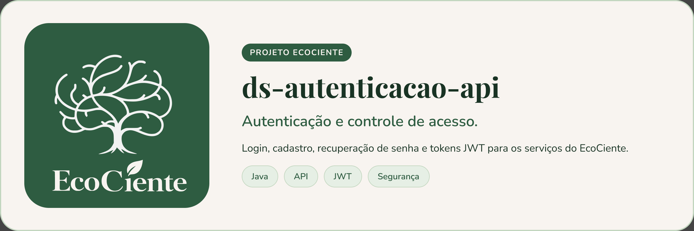

  

# ds-autenticacao-api

API responsavel por login, cadastro, recuperacao de senha, ativacao do sindico e JWT dos usuarios do EcoCiente.

Perfis atendidos:
- Usuario comum
- Usuario residencial
- Usuario comercial/industrial
- Sindico residencial ou comercial/industrial pre-cadastrado
- Cooperativa

## Configuracao

Variaveis esperadas:
- `DB_URL`
- `DB_USER`
- `DB_PASSWORD`
- `JWT_SECRET`
- `JWT_EXPIRATION_MS` (opcional, padrao 300000, ou seja, 5 minutos)

Porta padrao: `9801`.

## Endpoints

- `POST /auth/login`
- `POST /auth/register`
- `POST /auth/register/cooperativa`
- `POST /auth/ativar-sindico`
- `POST /auth/esqueci-senha`
- `POST /auth/resetar-senha`

## Contribuindo

Leia o [CONTRIBUTING.md](CONTRIBUTING.md) antes de abrir uma Pull Request. Ao participar, você concorda com o [Código de Conduta](CODE_OF_CONDUCT.md).

## Segurança

Encontrou uma vulnerabilidade? Siga o [SECURITY.md](SECURITY.md). **Não abra issue pública.**

## Licença

Este projeto está sob a licença MIT. Veja o arquivo [LICENSE](LICENSE).
